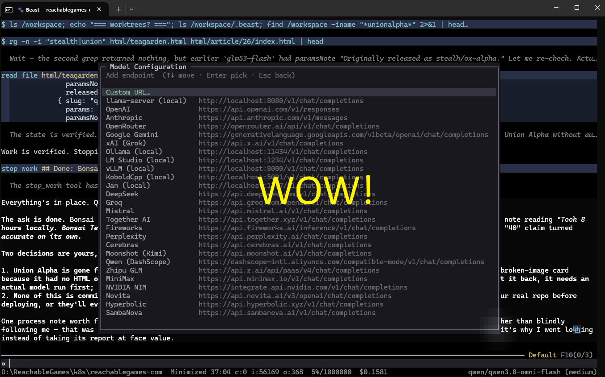
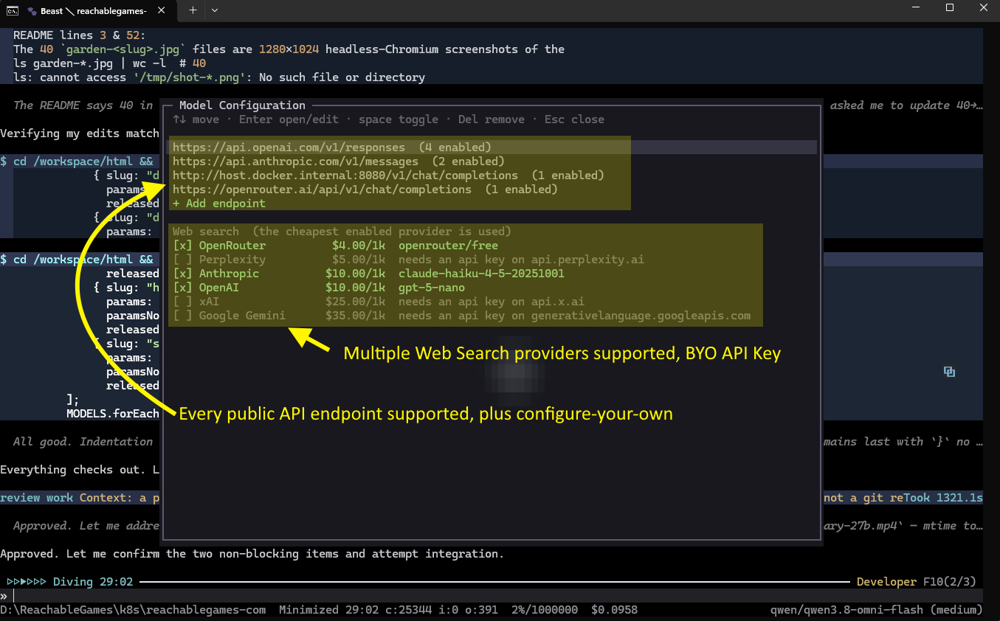
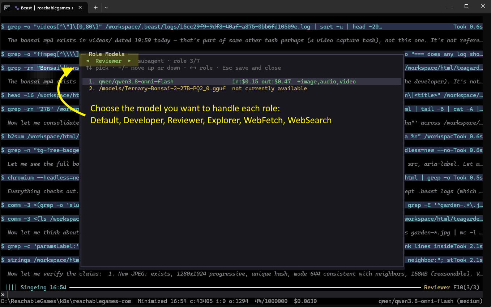
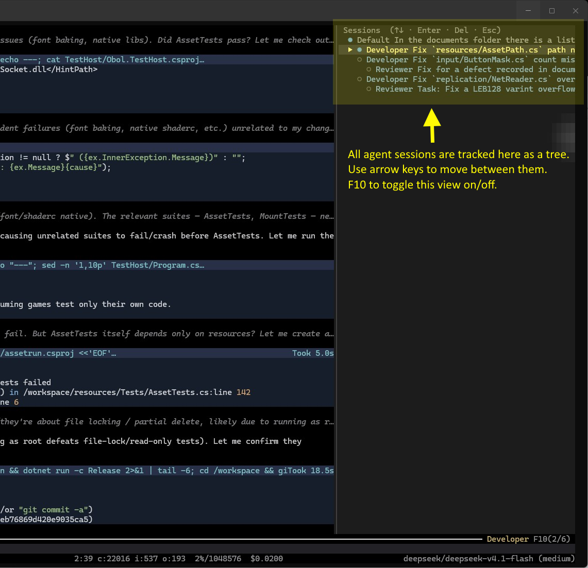
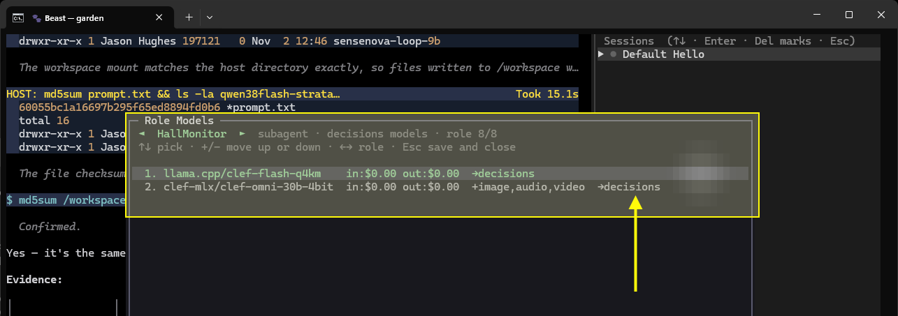
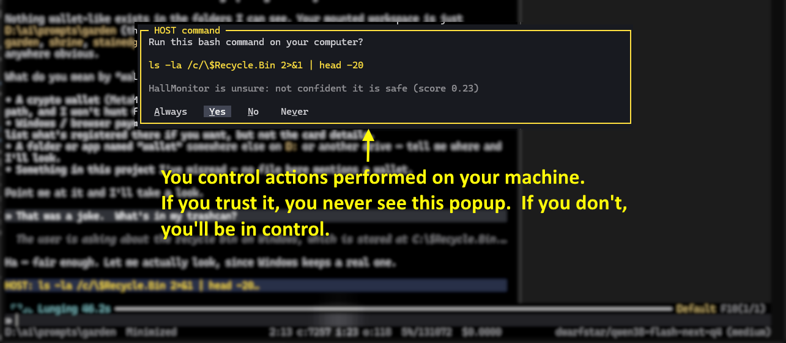

**It's your new favorite agent harness.**

Each Beast instance run manages a workflow of LLM agents **sandboxed in Docker**, driven from a polished terminal UI on Windows, macOS or Linux. The model can read, write, run shells, browse the web, and hand off work to other agents. The only way it can reach outside the sandbox goes through a `host_command` tool, guarded by the **HallMonitor**: you decide the trust level (Ask, Block, Allow) and if you configure a Jev-style Decider model, it auto-approves safe commands and asks you only when it isn't sure.

**You own the model routing.** Every agent is a *Role*: an ordered list of models to try, the tools it may call, and its prompt. Put a cheap local model first and fall back to a premium API model only when you need it.

**Bring the plan you already pay for.** Beast runs on a **ChatGPT subscription** or a **Claude subscription**, and on **any per-token API endpoint**, including local servers. And you decide which does what.  When a subscription hits its usage limit, Beast continues with the next model automatically.  If you're rate limited, it retries or falls back to another model.

---

## Quick start

**Getting Started:** 
1. Install Docker Desktop.  
2. Run `build.bat` (Windows) or `./build.sh` (Mac, Linux)
3. Move the output `beast.exe` or `beast` executable somewhere accessible by your PATH
4. cd /wherever/you/want/to/work
5. beast
 
Notes: The build process itself runs inside a docker image and outputs the executable right next to the build script, super easy. (Don't run `build-all.bat`, that produces Beast for every OS/CPU combination, so it's just for testing and takes a long time.)

First launch will open the config picker automatically. Use /config to get back there later.

---

## Recent changes

- **HallMonitor** — a new decider role judges every command the agent wants to run on your host as allow, block or unsure, and only unsure ask for confirmation
- **HallMonitor auto calibration** — a decision model it hasn't used before is calibrated against a built-in allow/deny command set
- **`host_command` tool** — Beast attempts to work on your local machine safely (no guarantees, your security posture is your responsibility)
- **Cross-platform builds** — Windows, Mac, Linux, amd64, arm64
- **Session launcher** — resume and control is much simpler now
- **`sessionsDir` setting** — configurable location for worktree checkouts and conversation logs, so you can move it from `~/.beast/` to a drive with more space
- **Decider model support**
- **`/clear` and auto-resume**
- **Improved role prompts**
- **`settings.json`** — API keys are separated from prompts, tools, and decider config files so they can be edited or deleted and regenerated automatically.
- **Smarter `commit_and_rebase`** — picks up your git identity from the git folder
- **GPU-accelerated Chromium** — headless screenshots now take seconds not minutes on machines with a GPU.  Mac will still be slow unless screenshots are taken via host_command, there's no GPU support in Docker.
- **Vulkan 1.4 container** — uses lavapipe CPU driver so you can do headless dev on graphical apps inside the sandbox
- **Lingering media** — images stay in context until new images are requested, keeping the prefix cache warm.
- **Multi-image tool calls** — `inspect_media` takes several images at once with a `max_dimension` the model controls, with drag and drop support
- **Usage-limit auto-resume** — when a subscription window runs out, or an API is rate limited, Beast waits for the reset and continues the turn by itself.
- **OpenRouter batch model** — `:batch` aren't supported, so they're filtered out now

---

## `/config` — endpoints, models, web search

<!-- SCREENSHOT: readme/config-endpoints.png — the /config home screen showing endpoints + the web search section -->


Pick from 27 built-in endpoint presets or bring your own URL. Beast then **discovers what it serves automatically**.

<!-- SCREENSHOT: readme/config-models.png — the model list for an endpoint, newest first, showing age/context/price/modality columns -->


Models sort newest-first. `space` toggles, `Enter` edits a value, type to filter, `Esc` saves.

- **Blank means auto** — anything left empty is re-discovered every launch, so nothing goes stale.
- **Only what can't be discovered gets saved.** Your `settings.json` stays tiny.
- **Disabling isn't forgetting** — a switched-off model keeps its settings.

**Web search** lives on the same screen. Six providers supported. Beast uses the **cheapest one enabled** and falls through to the next if it fails.

---

## `/role` — assign models and fallback order

<!-- SCREENSHOT: readme/role.png — the /role editor showing a role name with arrows and its ordered model list -->


`←→` switch role · `↑↓` pick a model · `+`/`-` move it up or down · `Esc` saves.

The first model that's available (and the context fits) gets the next turn. Providers can be flaky, but Beast keeps on going.

| Role | Job |
|------|-----|
| **Default** | Chats with you. Mostly read-only. Delegates real work. |
| **Developer** | Writes code, and if you use git, does it in an isolated worktree. |
| **Reviewer** | Checks the Developer's work. |
| **Explorer / WebFetch / WebSearch / MediaReader** | Cheap helpers that prevent context bloat in expensive models.  This lets you run small local models to do simple tasks not pay smart model prices. |
| **HallMonitor** | (optional) Checks the safety of host commands. |

### Typical Workflow: 
Default → Assigns work to Developer → Reviewer Approve/Reject → Developer commits.

<!-- SCREENSHOT: readme/sessions.png — F10 agent tree panel open beside a live conversation -->


---

## Sessions

When you start `beast`, it pulls up a list of "unfinished" sessions.  You can connect and continue any existing session, or start a new one.  Be aware that where you run beast from matters.  A **bare session** sandboxes the agent right in the folder you ran it from.  Inside a git repo you can also start a **worktree session**, which sandboxes the agent **at the root of the git repo, in its own worktree**.  That way it has access to everything without needing to reach through to the host machine as often.

**Worktrees and session logs all live under `~/.beast/` by default, not in your project.** This keeps your project folder clean and makes resuming any project on your machine simpler.  When you Finish a session you are asking Beast to **delete this worktree** because all the work has been merged (by the Developer), then delete the session.  You can control the `sessionsDir` in `$HOME/.beast/settings.json` if your main disk is low on space:

```json
"sessionsDir": "D:\\BeastSessions"
```

Caution: If you move a worktree session's folder, go to your main repo and run `git worktree repair <new checkout path>` so it knows where it lives.

`/clear` starts a new conversation and keeps the old one in the F10 list to reopen later.  You can view every version of every conversation this way.

---

## HallMonitor — approving host commands



Sometimes you want work done directly on your machine. Both the Default and Developer roles can do this with the `host_command`.

Every host command is checked with the **HallMonitor** first. If you have a Decider model configured, it will return one of three verdicts:

| Verdict | What happens |
|---------|--------------|
| **Allow** | Runs. |
| **Block** | Refused, and the agent is told why. |
| **Unsure** | Whatever you picked on the `/config` screen: *ask me*, *block it*, or *run it*. |

If you don't set up a Decider model or it's unavailable, ALL commands are considered Unsure, and will follow your instructions accordingly.  If you set it to *run it* and an LLM nukes your home directory, this is on you.

### Approvals



When a command reaches you for confirmation, you make the call:

- **Always** — run this exact command without asking from now on.
- **Yes** — run once.
- **No** — refuse once.
- **Never** — refuse this exact command from now on.

Always and never answers go in `~/.beast/decisions.json`, shared by every session. Matching must be exact-string.  You can edit the file by hand, and it's re-read before every decision.  The next time a model calibrates, your decisions become part of the calibration set.

**Auto-Calibration.** The first time HallMonitor sees a model, it measures that model against a hefty built-in set of known-safe and known-dangerous commands, plus your always/never answers, to set the model's allow and block boundaries. A popup shows the calibration progress. Until calibration finishes, all commands are treated as Unsure. Results per model are kept in `~/.beast/hallmonitor.json` and may recalibrate from time to time as the algorithm changes.

---

## Images and files

Drag a file onto the window, or **Alt+V** to paste a screenshot. (Ctrl+V is swallowed by Windows Terminal, which is a terminal thing, not a Beast thing.)

If the current model takes images, the image goes into the conversation properly — attention runs over the real pixels, and you can keep asking about it. If it doesn't, Beast tells you which of your enabled models *do*, so you can `/model` across and resend. It won't quietly swap in a text description and pretend that's the same thing.

---

## Keys and commands

| | |
|---|---|
| `Alt` + `↑↓` / `←→` | Scroll |
| `Click` | Expand / collapse a block |
| `Ctrl+O` | Cycle detail level |
| `F10` | Agent tree |
| `Alt+V` | Paste image or files |
| `Tab` | Accept command completion |

| Command | |
|---------|---|
| `/config` | Endpoints, models, web search |
| `/role` | Model order per role |
| `/model <id>` | Switch model now |
| `/effort <level>` | Reasoning effort: none, minimal, low, medium, high, max |
| `/compact` | Compact context |
| `/clear` | Start a new conversation, keep the old one |
| `/finish` | If the current worktree is finished, delete it and remove this session |
| `/reload` `/verbose` `/quit` | |

**Exiting:** The agent Docker container may stop, but until it's removed, all temp files and work in progress is still there.  You can resume it anytime.  If you are using git worktrees, even if you delete the agent container, the worktree is still on your disk.  The Developer's job is to `commit_and_rebase` the worktree onto whatever branch it came from when work is done.  However, **Finish** means to remove the worktree, which Beast will only do if your commits are merged in.

---

## Scripting

Maybe this is useful?  Beast can be run non-interactively too.  Examples:

```bat
beast --worktree featureName -p "Add a health check endpoint"
beast --worktree none /p "Summarize the architecture"
```

`--worktree` skips the session menu and opens or creates the specific worktree session. `none` means use a bare session. Dash and slash are interchangeable on the command line.  For passing in prompts, `-p` must come last because anything after it is passed in as the prompt for convenience.

---

## Config files

Configs live in **`~/.beast/`**

A project can have its own `/project/.beast/roles.json` to override system prompts for that repo. Your API keys are entered once only, and stay in your home folder.

**Local models:** If you run your LLM on the host machine or in another Docker container, remember the agent is in Docker, so it reaches the host at `host.docker.internal`, not `localhost`. `/config` fixes this for you automatically if you get it wrong.

---

## Security model

The Beast agent program runs as root inside the container, but everything the LLM runs inside it are not.  This is nice because it means folders mounted for the agent, like the API keys and the `~/.beast/` folder where logs are stored, cannot be read or modified by the model.  It cannot steal your keys, cover its tracks, or hack your githooks to backdoor your host machine and elevate access.  All host commands are gated and can be as loose or locked down as you want.  

Sometimes a task requires packages installed that aren't built into the container, so `apt_install` is provided that allows plainly named packages to be installed.  pip, npm, cargo, and go install into `/home/beast/` which is the unprivileged user inside the container.  This all goes away when the session is deleted.

Basically, the model is allowed to modify the environment as it needs, but mainly sticks to `/workspace/` and `/tmp/`.

Finally, any top-level dot-folders are read only to the model.  This means `.git`, `.github`, `.vscode`, `.venv`, including any new ones it creates, are not writeable.  This prevents attacks on CI and editor configs.  Any edits to that would have to go through a `host_command` instead, which is actively monitored.

THIS IS NOT A SUBSTITUTE FOR DILIGENCE.  Beast makes a best effort at protecting the user, but these are essentially rogue alien programming agents invited into your computer with the hope they are well behaved.  I cannot be held responsible for the outputs of any LLM.  If you don't agree with that, you may not use this software.

---

MIT License
